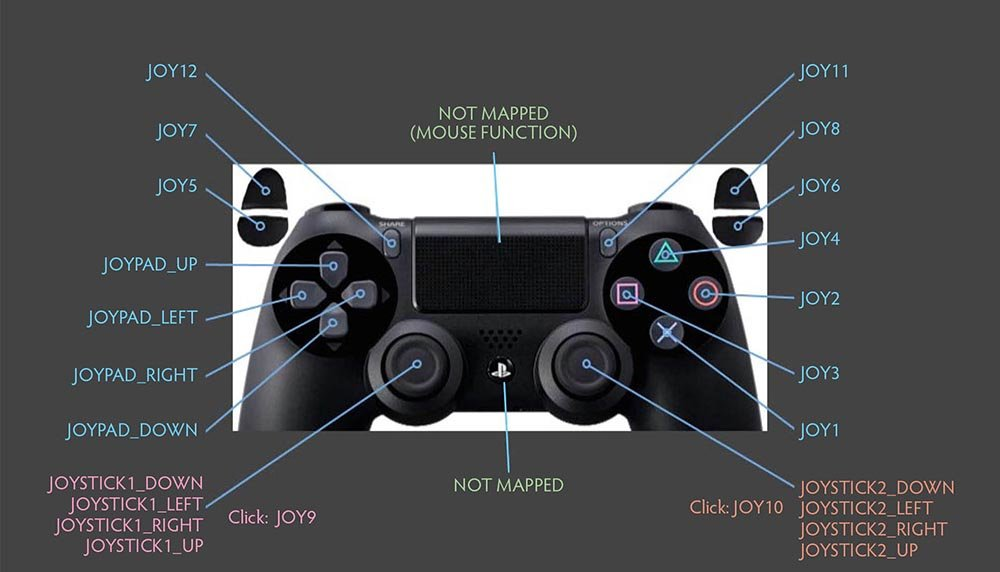
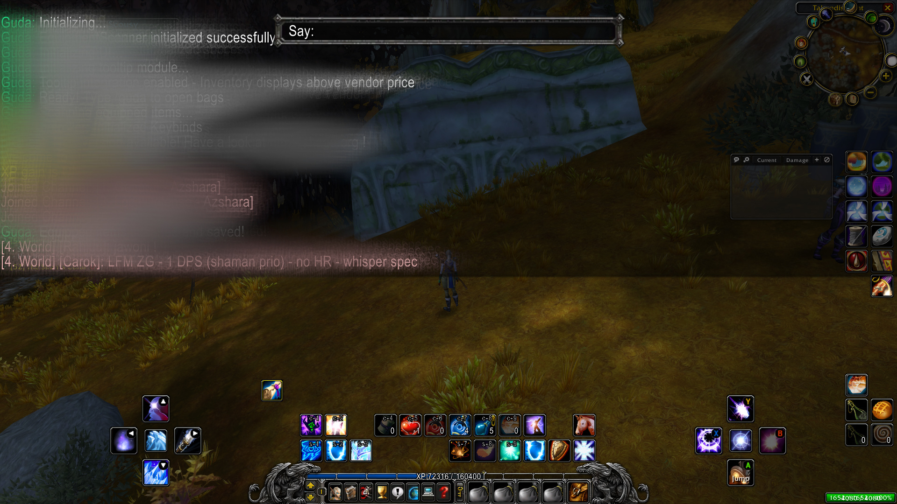
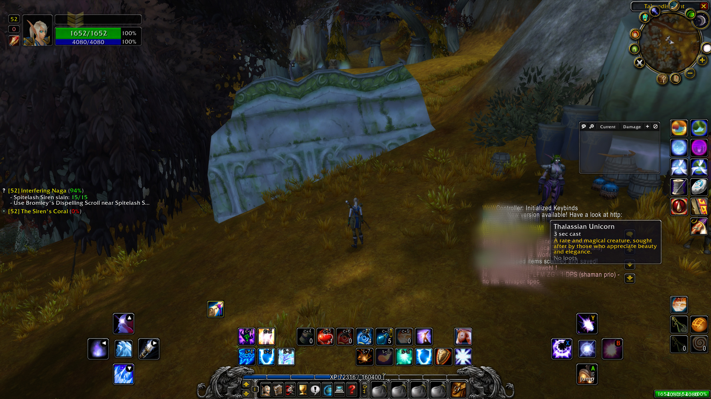

# WoWController

This is a fork of ShaguController (https://github.com/shagu/ShaguController) edited to be usable with Dualshock or Xbox Controller.

> WARNING: This addon changes in-game keybinds to align with the Controllers's 'Keyboard (WASD) and Mouse' layout. If you run this addon on your PC, you might need to restore your old keybinds manually after. I am currently working on changing this to individiual keybinds you can bind yourself.

## Installation (Vanilla, 1.12)
1. Download **[Latest Version](<repository-url>/archive/master.zip)**
2. Unpack the Zip file
3. Rename the folder to "WoWController"
4. Copy "WoWController" into Wow-Directory\Interface\AddOns
5. Restart Wow

## Keybinding

The addon sets in-game keybinds based on the button mappings provided by Controller "Keyboard (WASD) and Mouse"-Layout:

* The X button is bound to jump
* The Square, Rectangle and Circle buttons are bound to the 3 action buttons on the right side
* The D-Pad is bound to the 4 action buttons on the left side
* The R1 buttons ist used for next-target selection
+ The L1 Button is used to switch Actionbar Pages.
* The "Tab Key" opens the world map
* The "Left Trackpad" is bound to the 4 actions buttons on the left
* Right Touchpad: Toggle bags
* Share: Toggle quest log
* Left Touchpad: Toggle Worldmap
* Start: (ESC) Toggle Menu

## UI Changes

* The action bar size is reduced and got all action buttons removed, to have only the
bag buttons and the micro panel left.
* The normal action buttons are moved to the left and the right side
to match the gamepad layout.
* Action buttons got their keybinds replaced by gamepad button icons.
* Out-of-Range actions will be displayed as a gray-scaled texture.
* The loot window is automatically positioned to have the most relevant part of it under your cursor.
* The chat window sits in the top right corner, 5 cm away from the right edge, and got buttons removed.
* The mouseover tooltip is raised 5 cm from its default bottom-right position.
* Clicking on the chat window will zoom it and raise it above the rest of the UI to make space for the onscreen keyboard.

*Chat is moved, to make space for screen keyboard*

*Moved tool tip message so it cannot overlap with the action bar buttons*

# Install

Navigate to your World of Warcraft directory and install the add-on as usual:

    cd Interface/AddOns
    git clone <repository-url>
    cd -
